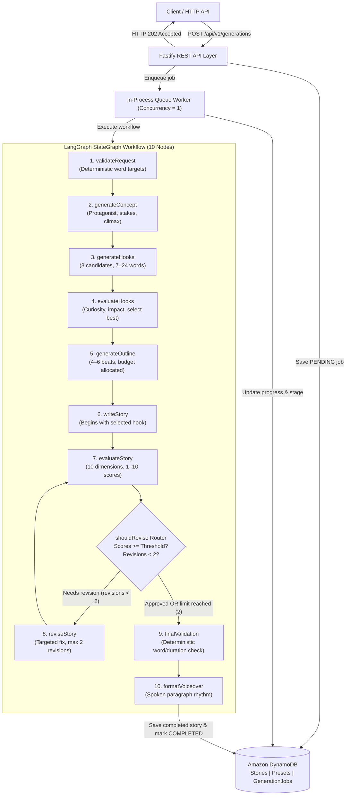

# Personal AI Story Generator — Backend

A single-user, voiceover-ready personal AI storytelling backend powered by **Amazon Bedrock** (`ChatBedrockConverse`) and **LangGraph** (`@langchain/langgraph`), built with **Fastify**, **TypeScript**, and **DynamoDB**.

---

## ⚠️ GLOBAL STORY LENGTH RULE (MANDATORY)

> **This application generates stories with a duration of 2–6 minutes ONLY.**
>
> - **Minimum duration:** 2 minutes
> - **Maximum duration:** 6 minutes
> - **Default duration:** 4 minutes
> - **Default speaking speed:** 145 words per minute (WPM), configurable between 120–180 WPM.
> - **Duration calculation:** `targetWordCount = durationMinutes * narrationWordsPerMinute`
> - **Tolerance window:** 5% tolerance clamped strictly within the absolute 2–6 minute boundaries.

```typescript
minimumWords = Math.max(
  2 * narrationWordsPerMinute,
  Math.floor(targetWordCount * 0.95)
)

maximumWords = Math.min(
  6 * narrationWordsPerMinute,
  Math.ceil(targetWordCount * 1.05)
)
```

### Word Count Reference Table (@ 145 WPM)

| Duration | Target Word Count | Minimum Words | Maximum Words | Estimated Seconds |
|---|---:|---:|---:|---:|
| **2 minutes** | 290 words | 290 words | 305 words | 120s |
| **3 minutes** | 435 words | 413 words | 457 words | 180s |
| **4 minutes** | 580 words | 551 words | 609 words | 240s |
| **5 minutes** | 725 words | 688 words | 762 words | 300s |
| **6 minutes** | 870 words | 826 words | 870 words | 360s |

Stories outside the 2–6 minute range are rejected during request validation and final deterministic validation.

---

## Architecture Overview



---

## Technology Stack

- **Runtime:** Node.js (>=20.0.0, ES Modules)
- **Language:** TypeScript 5.6 (strict mode, `exactOptionalPropertyTypes`)
- **API Framework:** Fastify 4 (`@fastify/helmet`, `@fastify/cors`, `@fastify/rate-limit`)
- **AI / LLM Orchestration:**
  - `@langchain/langgraph` (modular `StateGraph`, conditional edges)
  - `@langchain/aws` (`ChatBedrockConverse`)
  - `@langchain/core`
- **Schema Validation:** Zod 3.23
- **Database:** AWS SDK v3 DynamoDB (`@aws-sdk/client-dynamodb`, `@aws-sdk/lib-dynamodb` via `DynamoDBDocumentClient`)
- **Logging & Observability:** Pino, Pino-Pretty, Token & Cost Aggregation
- **Testing:** Vitest 2.1, V8 coverage

---

## AWS Setup & IAM Permissions

### Required IAM Policy

Attach the following policy to the IAM role or user running the application:

```json
{
  "Version": "2012-10-17",
  "Statement": [
    {
      "Sid": "BedrockConverseAccess",
      "Effect": "Allow",
      "Action": [
        "bedrock:InvokeModel",
        "bedrock:InvokeModelWithResponseStream"
      ],
      "Resource": [
        "arn:aws:bedrock:*::foundation-model/*"
      ]
    },
    {
      "Sid": "DynamoDBAccess",
      "Effect": "Allow",
      "Action": [
        "dynamodb:PutItem",
        "dynamodb:GetItem",
        "dynamodb:UpdateItem",
        "dynamodb:DeleteItem",
        "dynamodb:Query",
        "dynamodb:DescribeTable"
      ],
      "Resource": [
        "arn:aws:dynamodb:*:*:table/personal-story-generator-stories",
        "arn:aws:dynamodb:*:*:table/personal-story-generator-stories/index/*",
        "arn:aws:dynamodb:*:*:table/personal-story-generator-presets",
        "arn:aws:dynamodb:*:*:table/personal-story-generator-presets/index/*",
        "arn:aws:dynamodb:*:*:table/personal-story-generator-generations",
        "arn:aws:dynamodb:*:*:table/personal-story-generator-generations/index/*"
      ]
    }
  ]
}
```

The application supports **explicit API keys and credentials** configured via `.env` (or environment variables) for both Amazon Bedrock and DynamoDB. If explicit keys are omitted, it automatically falls back to the **AWS default credential provider chain** (`~/.aws/credentials`, ECS/EC2 instance metadata, or IAM role). AWS credentials are never hardcoded.

### DynamoDB Provisioning

A complete CloudFormation template is located at `infra/cloudformation.yaml`.

Deploy tables via AWS CLI:

```bash
aws cloudformation deploy \
  --template-file infra/cloudformation.yaml \
  --stack-name personal-story-generator-tables \
  --parameter-overrides Environment=production
```

Tables created:
1. `personal-story-generator-stories` (PK: `storyId`, GSI1: `GSI1PK` / `GSI1SK`)
2. `personal-story-generator-presets` (PK: `presetId`, GSI1: `GSI1PK` / `GSI1SK`)
3. `personal-story-generator-generations` (PK: `generationId`, GSI1: `GSI1PK` / `GSI1SK`)

---

## Environment Variables

Copy `.env.example` to `.env`:

```bash
cp .env.example .env
```

| Variable | Required | Default | Description |
|---|---|---|---|
| `NODE_ENV` | No | `development` | `development`, `production`, `test` |
| `PORT` | No | `4000` | HTTP listening port |
| `HOST` | No | `127.0.0.1` | HTTP binding host |
| `AWS_REGION` | No | `us-east-1` | AWS region for DynamoDB and SDK |
| `AWS_ACCESS_KEY_ID` | No | *(empty)* | General AWS Access Key ID (fallback for Bedrock & DynamoDB) |
| `AWS_SECRET_ACCESS_KEY` | No | *(empty)* | General AWS Secret Access Key (fallback for Bedrock & DynamoDB) |
| `AWS_SESSION_TOKEN` | No | *(empty)* | General AWS Session Token (for temporary IAM/SSO credentials) |
| `BEDROCK_REGION` | No | `us-east-1` | Amazon Bedrock region |
| `BEDROCK_ACCESS_KEY_ID` | No | *(empty)* | Dedicated Bedrock API Access Key (overrides `AWS_ACCESS_KEY_ID`) |
| `BEDROCK_SECRET_ACCESS_KEY` | No | *(empty)* | Dedicated Bedrock API Secret Key (overrides `AWS_SECRET_ACCESS_KEY`) |
| `BEDROCK_SESSION_TOKEN` | No | *(empty)* | Dedicated Bedrock Session Token |
| `BEDROCK_MODEL_ID` | No | `anthropic.claude-3-sonnet-20240229-v1:0` | Fallback Bedrock model ID |
| `BEDROCK_WRITER_MODEL_ID` | No | `anthropic.claude-3-sonnet-20240229-v1:0` | Dedicated writing model ID |
| `BEDROCK_EVALUATOR_MODEL_ID` | No | `anthropic.claude-3-haiku-20240307-v1:0` | Dedicated evaluator model ID |
| `BEDROCK_WRITER_MAX_TOKENS` | No | `3000` | Output token limit for writer |
| `BEDROCK_EVALUATOR_MAX_TOKENS` | No | `2000` | Output token limit for evaluator |
| `DYNAMODB_ACCESS_KEY_ID` | No | *(empty)* | Dedicated DynamoDB Database Access Key (overrides `AWS_ACCESS_KEY_ID`) |
| `DYNAMODB_SECRET_ACCESS_KEY` | No | *(empty)* | Dedicated DynamoDB Database Secret Key (overrides `AWS_SECRET_ACCESS_KEY`) |
| `DYNAMODB_SESSION_TOKEN` | No | *(empty)* | Dedicated DynamoDB Database Session Token |
| `DYNAMODB_STORIES_TABLE` | No | `personal-story-generator-stories` | DynamoDB stories table name |
| `DYNAMODB_PRESETS_TABLE` | No | `personal-story-generator-presets` | DynamoDB presets table name |
| `DYNAMODB_GENERATIONS_TABLE` | No | `personal-story-generator-generations`| DynamoDB generations table name |
| `DYNAMODB_ENDPOINT` | No | *(empty)* | Local DynamoDB URL (e.g. `http://localhost:8000`) |
| `LANGSMITH_TRACING` | No | `false` | Enable LangSmith tracing |
| `LANGSMITH_API_KEY` | No | *(empty)* | LangSmith API Key (or `LANGCHAIN_API_KEY`) |
| `LANGCHAIN_PROJECT` | No | `personal-story-generator` | LangChain project tag |

---

## The 10-Node LangGraph Workflow

1. **`validateRequest`**: Deterministic Node. Validates configuration against Zod schemas, clamps duration between 2 and 6 minutes, and calculates `targetWordCount`, `minimumWords`, and `maximumWords`.
2. **`generateConcept`**: Uses writer model to craft a coherent single-narrative concept (premise, protagonist, conflict, stakes, inciting incident, revelation, climax, resolution).
3. **`generateHooks`**: Generates 3 hook candidates (7–24 words, 3–10 seconds narration) that immediately raise an intriguing curiosity question.
4. **`evaluateHooks`**: Uses evaluator model to score hooks across 6 criteria (curiosity, clarity, impact, relevance, promise fulfillment, narration quality) and selects the strongest candidate.
5. **`generateOutline`**: Creates 4–6 compact narrative beats, assigning word budgets to ensure `sum(budgets) ≈ targetWordCount`.
6. **`writeStory`**: Generates the complete story script. The opening hook is strictly enforced as the exact first line.
7. **`evaluateStory`**: Scores the script across 10 dimensions (1–10). Inspects hook delivery and computes deterministic duration metrics.
8. **`shouldReviseRouter`**:
   - If `approvalStatus === 'APPROVED'` OR `revisionCount >= 2`: routes to `finalValidation`.
   - Otherwise routes to `reviseStory`.
9. **`reviseStory`**: Performs targeted adjustments addressing weaknesses without expanding scope or adding filler. Maximum 2 revisions allowed.
10. **`finalValidation`**: Deterministic Node. Validates that word count and duration are strictly within 2–6 minutes and verifies all quality thresholds.
11. **`formatVoiceover`**: Deterministic Node. Formats dialogue and paragraphs for natural spoken voiceover delivery.

---

## Background Worker & Job Lifecycle

- Runs in-process with a **concurrency limit of 1** (no Redis or external queue required).
- **Job States:** `PENDING` ➔ `PROCESSING` ➔ `COMPLETED` or `FAILED`.
- **Approval Status:** `APPROVED` or `NEEDS_REVIEW`.
- **Workflow Stages Reported:**
  - `VALIDATING_REQUEST`
  - `GENERATING_CONCEPT`
  - `GENERATING_HOOKS`
  - `EVALUATING_HOOKS`
  - `GENERATING_OUTLINE`
  - `WRITING_STORY`
  - `EVALUATING_STORY`
  - `REVISING_STORY`
  - `FINAL_VALIDATION`
  - `FORMATTING_VOICEOVER`
  - `SAVING_STORY`
  - `COMPLETED` / `FAILED`
- **Startup Recovery:**
  - On backend startup, `GenerationService.recoverOnStartup()` detects stale `PROCESSING` jobs and marks them `FAILED` (avoiding expensive runaway model calls).
  - Unprocessed `PENDING` jobs are safely re-enqueued.

---

## API Documentation & Examples

### 1. Start a Story Generation (`POST /api/v1/generations`)

Returns `202 Accepted` immediately with the `generationId`.

#### Example A: 2-Minute Story Request (Target: ~290 words)

```json
POST /api/v1/generations
Content-Type: application/json

{
  "configuration": {
    "genre": "horror",
    "pov": "first_person",
    "tense": "present",
    "durationMinutes": 2,
    "narrationWordsPerMinute": 145,
    "mood": ["dark", "disturbing", "eerie"],
    "hookStyle": "intriguing_confession",
    "endingStyle": "dark",
    "pacing": "fast",
    "narrativeStyle": "personal_confession",
    "language": "English",
    "theme": "A lighthouse keeper discovers footprints emerging from the sea"
  }
}
```

#### Example B: 3-Minute Story Request (Target: ~435 words)

```json
POST /api/v1/generations
Content-Type: application/json

{
  "configuration": {
    "genre": "psychological_thriller",
    "pov": "first_person",
    "tense": "past",
    "durationMinutes": 3,
    "narrationWordsPerMinute": 145,
    "mood": ["dark", "suspenseful"],
    "hookStyle": "mysterious",
    "endingStyle": "unexpected_twist",
    "pacing": "gradually_escalating",
    "narrativeStyle": "conversational",
    "language": "English",
    "theme": "An archivist finds tape recordings of interviews from tomorrow"
  }
}
```

#### Example C: 6-Minute Story Request (Target: ~870 words)

```json
POST /api/v1/generations
Content-Type: application/json

{
  "configuration": {
    "genre": "science_fiction",
    "pov": "third_person_limited",
    "tense": "past",
    "durationMinutes": 6,
    "narrationWordsPerMinute": 145,
    "mood": ["mysterious", "tense", "eerie"],
    "hookStyle": "impossible_situation",
    "endingStyle": "thought_provoking",
    "pacing": "balanced",
    "narrativeStyle": "cinematic",
    "language": "English",
    "theme": "A deep-space salvage crew discovers a vessel that departed Earth centuries in the future"
  }
}
```

#### Response (`202 Accepted`)

```json
{
  "generationId": "550e8400-e29b-41d4-a716-446655440000",
  "status": "PENDING",
  "createdAt": "2026-11-06T00:00:00.000Z",
  "message": "Generation job started. Poll GET /api/v1/generations/:generationId for status."
}
```

---

### 2. Poll Job Status (`GET /api/v1/generations/:generationId`)

```json
{
  "generationId": "550e8400-e29b-41d4-a716-446655440000",
  "status": "COMPLETED",
  "currentStage": "COMPLETED",
  "storyId": "8f8b1b22-875b-48d6-946e-1d54e4c5b331",
  "wordCount": 431,
  "revisionCount": 0,
  "progressMessage": "Story generated successfully",
  "tokenUsage": {
    "totalInputTokens": 3200,
    "totalOutputTokens": 1450,
    "totalTokens": 4650,
    "estimatedCostUsd": 0.03135
  }
}
```

---

### 3. Retrieve Story (`GET /api/v1/stories/:storyId`)

```json
{
  "storyId": "8f8b1b22-875b-48d6-946e-1d54e4c5b331",
  "generationId": "550e8400-e29b-41d4-a716-446655440000",
  "title": "The Voices from Tomorrow",
  "script": "The magnetic tape hissed, and then my own voice spoke words I had not yet lived to say...\n\nI run the basement archive of the Saint Jude broadcasting museum...",
  "wordCount": 431,
  "targetDurationMinutes": 3,
  "narrationWordsPerMinute": 145,
  "estimatedDurationSeconds": 178,
  "approvalStatus": "APPROVED",
  "evaluation": {
    "scores": {
      "hook": 9,
      "endingSatisfaction": 9,
      "coherence": 8,
      "voiceoverQuality": 9,
      "engagement": 8,
      "pacing": 8,
      "characterDevelopment": 8,
      "emotionalImpact": 8,
      "climax": 8,
      "configurationAdherence": 9
    },
    "overallScore": 8.4,
    "hookDelivered": true,
    "durationValidation": {
      "wordCount": 431,
      "estimatedMinutes": 2.97,
      "withinBounds": true
    }
  }
}
```

---

### 4. Presets Endpoints

- `GET /api/v1/presets`: List all presets (built-in system presets and custom user presets).
- `GET /api/v1/presets/:presetId`: Retrieve a preset.
- `POST /api/v1/presets`: Create a custom preset.
- `PATCH /api/v1/presets/:presetId`: Update a custom preset (system presets protected).
- `DELETE /api/v1/presets/:presetId`: Delete a custom preset (system presets protected).

---

## Observability & Cost Tracking

Model pricing is configured in `src/utils/token-usage.ts` via an extensible pricing registry. Costs are never assumed; if a model's pricing is unregistered, `estimatedCostUsd` safely returns `null`.

Tokens and latencies are accumulated from each LangGraph node into the generation job and persisted in DynamoDB:
- `byNode` breakdown (input tokens, output tokens, latency in ms, call count)
- Total tokens
- Total cost in USD

---

## Commands & Verification

### Development & Build

```bash
# Start dev server with file watcher
npm run dev

# Run TypeScript type check
npm run typecheck

# Production build
npm run build

# Start production server
npm start
```

### Testing

```bash
# Run unit & integration test suite (offline / mocked)
npm test

# Run tests with code coverage report
npm run test:coverage

# Bedrock offline configuration check
npm run test:bedrock

# Bedrock LIVE invocation test (requires AWS credentials)
npm run test:bedrock -- --live

# End-to-end smoke test (dry-run)
npm run test:smoke

# End-to-end smoke test (LIVE Bedrock + DynamoDB, 3-min story)
npm run test:smoke -- --live
```

---

## Deployment Note

This application is designed as a **long-lived Node.js process** (Docker container on AWS ECS Fargate, AWS App Runner, or an EC2 instance).

> **Do not deploy this generation workflow to short-timeout serverless runtimes (like 15-30s Lambda functions)**: multi-stage LLM generation, quality evaluation, and conditional revisions take 30–90 seconds to execute. The long-lived Node.js process ensures complete background job execution without timeout interruptions.

